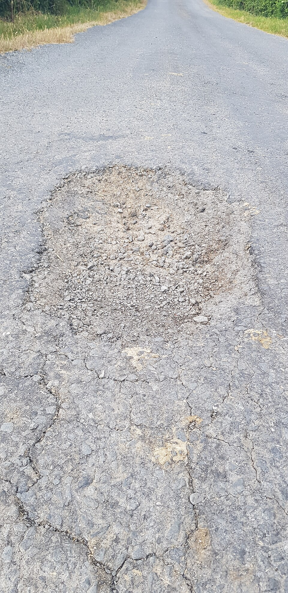
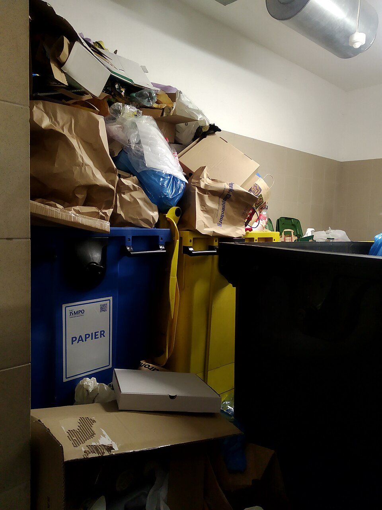

# Hivez API and OmniRoute Audit

**Audit date:** 2026-10-25  
**Workspace:** `D:\hivez`  
**Application under test:** local Hivez Vite server on `http://localhost:5173`; its non-OmniRoute `/api/*` requests proxy to `https://www.hivez.in`. The separate `5174` port was not reachable during this run.  
**Scope:** repository API inventory, safe live endpoint calls, actual image-based AI checks, OmniRoute local and production status, integration checks, and build/lint/test results.

## Remediation update — 2026-10-25

The initial behavior matrix recorded below had 11 passes and 9 failures. The Hive-intelligence issues were corrected and rechecked against the local OmniRoute instance:

- Hive search now shares the same deterministic matcher and category aliases as the application registry. The previously failing road, lamp, lost-pet, water, waste, bus-shelter, and signage examples all resolve to the expected Hive in the focused matrix.
- Report analysis avoids sending clearly personal complaints such as “My car is annoying” through proposal generation. Malformed or incomplete model JSON now produces a safe `UNCERTAIN` result without a Hive proposal.
- Description rewrites that add unsupported numbers or likely named places are discarded. Malformed rewrite output now returns a safe optional-detail hint. JSON-mode requests are enabled for the intelligence operations, with one compatibility retry when an upstream rejects that option.
- Duplicate comparison now handles high-confidence same-topic/location cases locally; the three duplicate/related/unrelated cases pass without relying on model JSON. It remains a server/API operation with no user-facing caller in the current UI.
- `node scripts/test-hive-intel.mjs`: **21 passed, 0 blocked, 0 failed**. The live new-Hive scenario returned a valid response; the sample image path returned `null` for image consistency because the matching Hive was found locally before image analysis. A mocked unsafe rewrite was also rejected.
- `node scripts/test-omniroute.mjs`: **26 passed, 0 blocked, 0 failed**, including new checks for JSON-mode request behavior and compatibility retry.
- `npm run build`: **passed**. Existing Vite notices about path-plugin support and large chunks remain.

Production is still not configured: a fresh `GET https://www.hivez.in/api/omniroute-status` returned `ok: false`, `apiKeyConfigured: false`, and `baseUrl: http://localhost:20128/v1`; a synthetic description-assistance POST returned `missing_api_key`. This cannot be corrected by local code changes. A Vercel-reachable OmniRoute base URL and server-side API key must be configured in the production environment. The local router URL is not reachable by Vercel. No environment file or production setting was changed.

## Executive summary

The core report-verification flow works against a real road-damage image. `/api/verify-report` returned `VERIFIED` with four successful visual checks. Gemini separately classified both a pothole image and an overflowing-waste image correctly. Ultra Bee also returned a relevant answer.

OmniRoute has a significant deployment gap: the local router is reachable and its client/route diagnostics pass, but the **deployed** `/api/omniroute-status` reports `apiKeyConfigured: false`, and the deployed `/api/omniroute-intel` returns `missing_api_key`. Semantic features therefore work locally but are unavailable in production at the time of this audit.

The live verification fan-out also has provider-specific configuration failures: xAI rejected its configured credential, Groq Qwen 3.6 returned a model-not-found response, and NVIDIA Nemotron Ultra is explicitly configured as non-vision. The other four provider calls completed for the pothole sample and reached consensus.

The first live intelligence matrix had **11 passes and 9 failures**: three search expectations were wrong or empty, three issue-analysis calls returned unusable model output, and all three semantic duplicate comparisons returned `invalid_response`. Those local behavior failures have since been fixed and the rerun passed **21/21** cases. Production still cannot use OmniRoute because its server-side key is absent.

No production account, post, chat, push token, or stored media asset was created. Authenticated/write flows and the Firebase event triggers were inventoried but not exercised against production. The Cloudinary checks intentionally stopped at request validation to avoid storing test files.

## What Hivez currently calls an API

Hivez has a small set of HTTP routes, while most social/product data operations use Firebase SDK RPCs directly from the browser. The routes and the service integrations are distinct layers.

### Hivez HTTP routes

| Route | Function | Actual usage | Audit result |
|---|---|---|---|
| `POST /api/verify-report` | Runs local-device verification data through a configured multi-provider image-verification fan-out, combines votes, and returns a decision and consensus summary. | Called by `src/services/reportVerification.ts` after the local Teachable Machine check. | **Live pass:** road-damage image returned `VERIFIED`, score `1.00`, agreement `1.00`, 4 successful checks across 4 configured provider groups. Three provider entries were unavailable/failed; details below. |
| `POST /api/gemini-verify` | Standalone Gemini image/category check returning category match, image relevance/quality, detected objects, confidence, severity, and a short reason. | No current frontend caller was found. It overlaps with Gemini's role inside `/api/verify-report`. | **Live pass:** pothole and waste examples both matched their selected categories. This route appears unused by the current UI. |
| `POST /api/ultra-bee` | Adds the Hivez assistant system prompt and sends Direct Message turns to OpenRouter. | Called by `src/services/ultraBee.ts`; Ultra Bee lives in the Chats experience. | **Live pass:** returned a relevant Hivez description using `nvidia/nemotron-3-ultra-550b-a55b:free`. No real account or chat was created. |
| `POST /api/omniroute-intel` | Server-side gateway for hive search, report analysis, description assistance, and duplicate comparison. | Called by `src/services/omnirouteIntel.ts`; local-only Vite middleware runs the same handlers during development. | **Local:** focused operation matrix **21/21 passed** after remediation. **Production:** `missing_api_key`; semantic operations are unavailable there until environment configuration is restored. |
| `GET /api/omniroute-status` | Diagnostic check for server reachability, authentication, model listing, and a completion round trip. It is not a user feature. | Used by local diagnostics only. | **Local pass:** router, key, models, and completion worked. **Production:** HTTP 200 diagnostic response, `ok: false`, no configured key; completion skipped. The route is publicly readable and reveals configuration status. |

POST-only routes returned HTTP 405 to GET requests during route checks. OmniRoute's local route harness also passed method, malformed JSON, payload-size, and secret-isolation checks.

### Firebase-backed product API

`src/firebase/firebase.ts` initializes Firebase Auth, Firestore, Firebase Messaging, and Firebase Storage. The active app services use Auth and Firestore extensively; uploads found in the current UI use Cloudinary rather than Firebase Storage.

| Product area / files | What the API supports |
|---|---|
| `src/services/auth.ts`, `src/context/AuthContext.tsx` | Email/password registration and login, Google popup sign-in, sign-out, and password recovery. These are Firebase Authentication SDK calls, not Hivez HTTP routes. |
| `src/services/user.tsx`, `completeProfile.ts`, `privacy.ts`, `profileCache.ts`, `followRequests.ts`, `blocks.ts` | User/profile reads and updates, username registration, privacy controls, follow requests, followers/following, and blocking. |
| Feed, post, comment, re-hive, saved-post, and engagement services | Firestore reads/writes and listeners for posts, comments, reactions, shares, saves, and engagement records. The public post/report creation UI writes through Firebase rather than a custom `/api/posts` route. |
| `src/services/volunteering.ts`, `hives.ts`, `communityUpdates.ts` | Hive/community membership, issue discussions, polls, volunteer activities/groups, participation, and evidence/progress updates. |
| `src/services/notifications.ts`, `dmSharing.ts`, `pushNotifications.ts` | In-app notifications and direct-message records; browser push permission/token registration with Firebase Cloud Messaging. |
| `src/services/admin.ts` | Admin-only data reads and mutations for accounts, posts, reports, settings, broadcasts, and logs. These operations must remain governed by Firestore rules and authenticated roles. |
| `src/services/mapPosts.ts`, `location.ts` | Location is obtained through the browser Geolocation API; nearby report data comes from Firestore queries. No external geocoding API was found in the map path. |

**Read-only security probe:** a direct unauthenticated Firestore read for a synthetic, nonexistent user document returned HTTP 403 `PERMISSION_DENIED`. This confirms an unauthenticated request was denied; it does not prove every collection rule is correct.

**Not run against production:** successful sign-up/login, username/profile writes, post/comment/message creation, follows, volunteer membership, push-token registration, admin operations, and Firebase-triggered notifications. Those tests would create or alter production user/content data or send notifications. There is no disposable staging account/project identified in this repository state.

### Firebase Functions

`functions/src/index.ts` exports:

- `pushSocialNotification`: Firestore `notifications/{notificationId}` create trigger; sends FCM notifications for social events other than messages.
- `pushChatMessage`: Firestore chat-message create trigger; sends the recipient a push notification and deliberately skips Ultra Bee replies.
- `verifyReportWithGemini`: Firebase callable that independently invokes Gemini for an image check. No frontend `httpsCallable` caller was found; it duplicates the standalone `/api/gemini-verify` capability. It was not invoked because doing so would call a deployed function and potentially consume the Gemini quota.

The two notification functions are event triggers, not standalone HTTP endpoints. Triggering them for a live test would require writing a real Firestore document and could send a real notification, so they were not fired.

### Other external/runtime APIs

| Integration | Current function | Result / limit |
|---|---|---|
| Cloudinary unsigned upload | Images and videos in report creation, profile editing/onboarding, and volunteering evidence. Shared helper is `src/services/mediaUpload.ts`; report creation and profile components also have direct Cloudinary calls. | Image and video upload endpoints returned the expected HTTP 400 “Missing required parameter - file” when sent an empty validation request; no asset was created. Successful uploads were intentionally not attempted because that would persist test media in the production cloud. |
| OpenStreetMap raster tiles | `src/pages/Map/Map.tsx` loads `https://tile.openstreetmap.org/{z}/{x}/{y}.png`; Firestore supplies report markers. | Live tile request returned HTTP 200 `image/png` (7,750 bytes). This tests tile availability, not map query/render interactions. |
| TensorFlow.js / Teachable Machine assets | `src/services/teachableMachineService.ts` lazily loads local model JSON, weights, and metadata from `public/models`. A first classification runs in the browser before cloud verification. | Model integrity/load smoke check passed 10/10 model directories. That harness feeds a zero tensor, so it verifies model structure/output shape and finite values—not classification of the two audit photos. |
| Browser geolocation | Native `navigator.geolocation`, used for map/profile location context. | Not prompted during this audit; permission would change browser state and location access is user-controlled. |
| UI avatar image fallbacks | `ui-avatars.com` and one `i.pravatar.cc` fallback are referenced in UI components. | Display fallback services only; no authenticated app data or API business logic. Not separately exercised. |

## OmniRoute: where it is used

The route/service/feature map below reflects the actual call sites found in the repository.

1. **Hive search and discovery** — `src/components/hiveSearch/HiveSearch.tsx` calls `intelSearchHives` in `src/services/omnirouteIntel.ts`. It first builds a local Hive registry and uses deterministic matching; the model is intended as a fallback for weak or ambiguous searches. It may map colloquial phrases to existing Hives but must not invent IDs.
2. **Report description assistance** — `src/pages/Create/Create.tsx` calls `intelAssistDescription` from the optional “improve wording” action. The suggestion is optional and must preserve the reporter's facts.
3. **New report / Hive routing** — the same Create page calls `intelAnalyzeIssue` to check whether an existing Hive fits or whether a new Hive proposal should be shown. The request may contain a compressed image. The code tries image-plus-text, then retries text-only if the selected upstream cannot accept the image; in that fallback, it must not invent an image consistency result.
4. **Semantic duplicate comparison** — the gateway operation exists in `api/omniroute-intel.ts` and the browser wrapper exists as `intelCompareDuplicates` in `src/services/omnirouteIntel.ts`. **No UI caller was found.** The operation is implemented at the service layer but is not currently part of the user journey.
5. **Transport and diagnostics** — `lib/omniroute/client.ts` calls OpenAI-compatible `/chat/completions` and `/models` server-side. `api/omniroute-status.ts` and `lib/omniroute/devServer.ts` support diagnostics/local development. The browser does not call the router directly or receive its API key.

OmniRoute is separate from Ultra Bee's OpenRouter client, the Gemini route, the multi-provider verifier, Firebase, and the local Teachable Machine models.

### OmniRoute operation results

The following manual live requests were sent to the **local** Hivez OmniRoute gateway using synthetic, non-user content:

| Operation | Result |
|---|---|
| `searchHives` | **Pass after remediation:** all tested deterministic, alternate-phrase, provisional/emerging, and weak-search fallback cases mapped correctly in the 21-case matrix. |
| `analyzeIssue` | **Pass after remediation:** a new bus-shelter report returned a validated proposal; an existing waste issue routed to its Hive; a private car complaint returned `NOT_A_MEANINGFUL_REPORTABLE_ISSUE`. For the pothole-plus-image sample, `descriptionImageMatch` was `null` because deterministic matching short-circuited before image analysis; no image judgment is claimed. |
| `assistDescription` | **Pass after remediation:** returned optional clearer wording for a short road report; unsupported place names/numbers are now filtered before returning a suggestion. Short reports receive a deterministic completeness hint. |
| `compareReportsForDuplicates` | **Pass after remediation:** identical-style reports classified as `POTENTIAL_DUPLICATE`, same-topic reports with broader scope as `RELATED`, and street-light versus parking reports as `UNRELATED`. These cases are handled deterministically; the UI still has no caller for this operation. |

### Local/production status split

- `npm run omniroute:check` passed against the local router.
- `node scripts/test-omniroute.mjs` passed **26/26** checks, including mock-server error handling, JSON-mode behavior and fallback, local authentication, model listing, a completion round trip, route validation, and secret-redaction assertions. The live completion resolved the `auto` choice to `allam-2-7b`; the latest local `/models` check returned 1,281 IDs.
- `node scripts/test-hive-intel.mjs` is an application behavior matrix, not just a transport test. The initial baseline was **11 passed, 9 failed**; after remediation it passed **21/21**.
- The deployed `https://www.hivez.in/api/omniroute-status` returned HTTP 200 but `ok: false`, `apiKeyConfigured: false`, and an unreachable `localhost` router; the completion check was skipped.
- A deployed `POST /api/omniroute-intel` description-assistance request returned HTTP 200 with `ok: false`, `error: missing_api_key`.

Local OmniRoute development being healthy does not mean the deployed Hivez semantic features are currently enabled.

## Image test assets and live results

These two samples are saved in [`artifacts/api-audit/images`](artifacts/api-audit/images/). They are licensed Wikimedia Commons images, visually inspected for the stated subject, and used only for API testing—not uploaded as Hivez reports.

### Road-damage sample

Source: [Pothole on local Road in County Monaghan.jpg](https://commons.wikimedia.org/wiki/File:Pothole_on_local_Road_in_County_Monaghan.jpg), CC0, by Computerfan0. Local file: [`pothole-local-road.jpg`](artifacts/api-audit/images/pothole-local-road.jpg).

### Overflowing-waste sample

Source: [Overflowing paper bin.jpg](https://commons.wikimedia.org/wiki/File:Overflowing_paper_bin.jpg), CC0, by Mateusz Konieczny. Local file: [`overflowing-bin.jpg`](artifacts/api-audit/images/overflowing-bin.jpg).

### `/api/verify-report` provider matrix (road image, `broken_road`)

| Configured provider | Status | Observation |
|---|---|---|
| Gemini (`gemini-3-flash-preview`) | Completed | Correctly saw a pothole and road cracks; about 6.9 s. |
| xAI Grok (`grok-4.6`) | Failed | HTTP 400: provider rejected the configured API credential. The credential value is omitted from this report. |
| NVIDIA Nemotron Ultra (`nvidia/nemotron-3-ultra`) | Unsupported | Explicitly configured as not supporting image verification; it was skipped. |
| NVIDIA Nemotron 3 Nano Omni | Completed | Correctly described pothole/broken asphalt; about 2.7 s. |
| OpenRouter Free | Completed | Correct image match; about 4.6 s. The resolved model ID was `nvidia/nemotron-3-nano-omni-30b-a3b-reasoning:free`, the same model family as the direct NVIDIA Omni call. |
| Groq Qwen 3.6 27B (`qwen/qwen3.6-27b`) | Failed | HTTP 404: configured model was reported unavailable/not found. |
| Groq Qwen 3.8 27B (`qwen/qwen3.8-27b`) | Completed | Correctly identified road damage; about 3.3 s. |

Final response: `VERIFIED`, verification score `1.00`, agreement `1.00`, 4 successful cloud checks. The API's four “independent groups” are provider-route groups; because OpenRouter resolved to the same NVIDIA model family as the direct NVIDIA check, they are **not four distinct model families**. Consensus therefore looks stronger by provider group than by model diversity.

### Standalone Gemini route

Both live calls returned HTTP 200, `ok: true`, `imageQuality: good`, `matchesCategory: true`, and `imageRelevant: true`:

- Pothole image + `broken_road`: confidence `0.98`; detected pothole/cracks/asphalt road.
- Waste image + `garbage`: confidence `0.98`; detected overflowing recycling/waste bins and packaging.

The reported severity (`medium` for road damage, `high` for waste) is model output, not a real-world risk assessment. It should remain advisory.

## Focused test results and failures

### OmniRoute client/route suite

`node scripts/test-omniroute.mjs`: initial audit **24 passed**; after adding structured-output coverage **26 passed, 0 blocked, 0 failed**. It covers defaults and overrides; missing configuration; Authorization/model plumbing; JSON-mode request and unsupported-mode retry; controlled 401, 429, 500, malformed JSON, empty choices, connection refusal, and timeout handling; models parsing; completion diagnostics; live local connectivity; and secret-free status/intelligence route behavior.

### Hive-intelligence behavior matrix

`node scripts/test-hive-intel.mjs` initial audit baseline: **11 passed, 9 failed**. The repaired current run is documented at the start of this report. Baseline failures were:

- Search: “huge hole in the road” returned no match; “broken lamp” mapped to public signage; “dog missing” returned a weak related match for missing persons rather than the Lost Pets Hive.
- Issue analysis: new bus-shelter issue, waste issue already covered by a Hive, and a non-community personal complaint each returned `invalid_response` instead of a valid normalized result.
- Duplicate comparison: duplicate, related, and unrelated report pairs all returned `invalid_response` rather than a verdict.

The passing cases included deterministic/alias matching for several categories, provisional/emerging Hive discovery, duplicate-Hive avoidance, description assistance, the unreachable-router fallback, and a structurally safe null image-consistency result. This was the initial baseline before the remediation update above; the updated run passed all 21 checks.

### Local model asset smoke test

`node scripts/test-local-ai.cjs`: **10/10 model files loaded**, output shapes matched metadata labels, weights lengths matched manifests, and output values were finite. This harness used zero-valued input tensors. The cloud verification tests above are the tests that actually received the downloaded real images.

### Build, lint, and local route tests

- `npm run build`: **passed after remediation** (`tsc -b` and Vite production build). Vite warned about the `vite-tsconfig-paths` plugin now being natively supported and about minified chunks larger than 500 kB.
- `npm run test:local`: **4/4 passed** (from the local OmniRoute environment test run).
- Focused `npx eslint` on changed OmniRoute source/service and test files: **passed**. The earlier full-repository `npm run lint` result was **210 errors and 3 warnings** across unrelated existing files; that broad lint result was not rerun in this remediation.

## Security, reliability, and operational findings

1. **Production OmniRoute is not configured.** Add server-side `OMNIROUTE_BASE_URL` and `OMNIROUTE_API_KEY` to the deployed environment, then rerun the hosted status and behavior checks. Keep the key out of `VITE_*` variables and client bundles.
2. **Provider health needs maintenance.** Replace/repair the xAI credential, confirm a currently accessible Groq Qwen 3.6 model ID or disable that entry, and either enable vision for Nemotron Ultra or remove it from image verification. Keep the working Gemini/NVIDIA Omni/OpenRouter/Groq 3.8 routes.
3. **The verification consensus overstates model diversity.** OpenRouter Free and NVIDIA Omni resolved to the same NVIDIA model family in this run. De-duplicate by resolved model family/provider or count route diversity separately from model diversity before treating consensus as independent corroboration.
4. **OmniRoute output schemas are guarded more strongly after remediation.** The gateway requests JSON mode with a compatibility retry for providers that reject it; incomplete issue JSON becomes a safe uncertain result; malformed rewrite JSON falls back to a safe hint; weak search candidates are thresholded; deterministic duplicate comparisons cover clear pairs. Retain conservative clarification and no-auto-merge/no-auto-reject behavior.
5. **AI routes accept unauthenticated POSTs.** The live Ultra Bee and image-check requests succeeded without an Authorization header; route code validates a non-empty `uid` field for Ultra Bee but does not verify a Firebase ID token. `/api/verify-report`, `/api/gemini-verify`, and `/api/omniroute-intel` likewise have no user authentication in the inspected handler. Add Firebase token/App Check verification, per-user limits, request-size limits, and abuse/cost controls appropriate to each route.
6. **The status endpoint is public.** Production GET returned its `apiKeyConfigured` boolean and router/model diagnostics. Restrict it to development/admin access or return a minimal public health response.
7. **Cloudinary writes are browser-direct.** The app uses an unsigned upload preset. Configure preset limits for file size, allowed formats, resource types, and destination folders, and monitor abuse. A successful upload was not tested because it would create a persistent production asset.
8. **Duplicate Gemini surfaces should be consolidated or explicitly assigned.** The standalone route and callable function overlap with Gemini inside `/api/verify-report`; the current UI only uses the multi-provider route. Unused callable code increases operational drift.

## Recommended OmniRoute uses (not implemented)

These are proposals, not claims about current behavior:

1. **Duplicate suggestions:** call `compareReportsForDuplicates` after deterministic same-Hive/time/location filtering. Show “possibly the same issue” with both source reports; never merge or close automatically.
2. **Better discovery:** use semantic query expansion in Explore/feed search after local text matching fails, and return a short explanation plus links to real posts/Hives.
3. **Volunteer matching:** rank activities by stated skills, time, and approximate area after deterministic eligibility filters. Let the person choose; do not infer sensitive traits.
4. **Progress summaries:** summarize existing report updates into a short timeline while preserving links and original text. Require source grounding and show the last-updated time.
5. **Accessible wording and translation:** offer user-controlled translation or clarity suggestions for a report, preserve names/places exactly, and let the author accept/edit/discard.
6. **Category-aware report prompts:** after a person chooses a report category, suggest the missing details that matter for that category (for example, which crossing or which pipe), as questions only. Never fill answers in for them.
7. **Hive taxonomy review:** cluster aggregate, non-identifying search terms and proposed Hive names to help admins notice a category gap or duplicate taxonomy. Keep the final category decision with an admin.
8. **“What changed in my Hives” digest:** summarize recent public updates from Hives the person follows and link each sentence to its source update. Let people opt in and choose cadence.
9. **Human-reviewed abuse triage:** flag likely spam or repeated submissions for a moderator queue with the triggering text snippets. Do not auto-hide, reject, or penalize a user based only on model output.
10. **Natural-language map and volunteer filters:** translate requests such as “nearby cleanups this weekend” into ordinary existing filter values, then show only real matching activities/posts returned by Hivez.

Use structured, minimal inputs, avoid sending private direct messages or precise location unless the user explicitly requests the feature, and keep decisions about safety, moderation, report rejection, and service actions with people.

## Changed files from this audit

- [`API_AND_OMNIROUTE_AUDIT_REPORT.md`](API_AND_OMNIROUTE_AUDIT_REPORT.md) — this detailed result, coverage, and recommendation report.
- [`artifacts/api-audit/README.md`](artifacts/api-audit/README.md) — image attribution and reproduction notes.
- [`artifacts/api-audit/images/overflowing-bin.jpg`](artifacts/api-audit/images/overflowing-bin.jpg) — CC0 sample used by the Gemini waste check.
- [`artifacts/api-audit/images/pothole-local-road.jpg`](artifacts/api-audit/images/pothole-local-road.jpg) — CC0 sample used by the report verifier, standalone Gemini, and OmniRoute issue-analysis request.

No application source, backend behavior, Firebase schema/rules, credentials, environment files, or production data were changed by this audit.

### Remediation files added after the initial audit

The preceding sentence described the initial audit only. This follow-up changed these files:

- `lib/omniroute/client.ts` - JSON-mode request support and retry for upstreams rejecting `response_format`.
- `lib/omniroute/intelligence/registry.ts` - common word-form normalization and high-confidence match checks.
- `lib/omniroute/intelligence/hiveSearch.ts` - JSON-mode semantic fallback with validated match confidence.
- `lib/omniroute/intelligence/issueAnalysis.ts` - private-complaint guard, safe handling for incomplete output, and filtering of rewrites that add unprovided places or numbers.
- `lib/omniroute/intelligence/duplicates.ts` - deterministic high-confidence duplicate/related/unrelated decisions before semantic fallback.
- `src/components/hiveSearch/HiveSearch.tsx` and `src/services/omnirouteIntel.ts` - align local and server search behavior and category aliases.
- `scripts/test-hive-intel.mjs` and `scripts/test-omniroute.mjs` - registry fixture alignment and focused regression coverage.

No Firebase schema/rules, authentication logic, credentials, environment files, or production data were changed. The production OmniRoute environment still requires a Vercel-reachable base URL and server-side API key.
